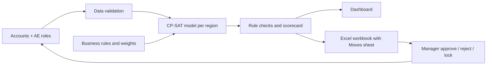

# Territory Optimisation Engine

[](https://colab.research.google.com/github/5d7/territory-optimisation-engine/blob/main/Territory_Optimisation_Engine_v2.ipynb)


**A constraint-based territory planning engine for revenue operations.** It reviews account ownership region by region, proposes which accounts to move into or out of each AE's territory, enforces your business rules, and explains every move in plain English, so planning becomes a repeatable, auditable cycle instead of a once-a-year spreadsheet exercise.


*Output of a demo run on randomly generated data (2,550 accounts, 30 AEs, 3 regions). The synthetic starting point is deliberately messy, so the move count is high. Real portfolios are tuned with the stability and move-limit controls described below.*

## The business problem

Territory and account assignment decisions drive coverage, capacity, quota attainment, and rep retention, yet most teams still manage them in spreadsheets. The typical result:

- Accounts with no owner, or with an owner who cannot legally or sensibly hold them
- Workload that is badly uneven, so some reps are overloaded while others are under-utilized
- Specialist accounts (for example AI-focused deals) sitting with non-specialists
- Rebalancing that is slow, political, and impossible to explain after the fact
- No way to answer "what if we change this rule?" without rebuilding the plan by hand

## What it does

| Question a RevOps leader asks | How the engine answers |
|---|---|
| Is every account covered by the right person? | Coverage and rule scorecard, before vs after |
| Is workload fair across the team? | Effort per AE against an allowed band, with spread before and after |
| How disruptive will the rebalance be? | Accounts kept with their owner, total moves, per-AE in/out limits |
| Why was this account moved? | A plain-English reason on every proposed move |
| What happens if we tighten a rule? | Side-by-side scenario comparison |
| Can managers shape the outcome? | Approve, reject, or lock moves, then feed decisions into the next cycle |

See **[docs/use-cases.md](docs/use-cases.md)** for detailed business scenarios: annual planning, mid-year rebalancing, new-hire and attrition coverage, M&A integration, and board-level scenario analysis.

## Sample output

Every proposed move carries its reason. Excerpt from the demo run:

| Account | Region | From | To | Annual revenue | Reason |
|---|---|---|---|---|---|
| ACC-01610 | EMEA | EMEA-AE-09 | EMEA-AE-06 | $3,268,823 | Acquisition AEs cannot hold customers or Tier 1 accounts. |
| ACC-01412 | EMEA | EMEA-AE-09 | EMEA-AE-03 | $2,859,949 | Enterprise AI account needs an AI specialist (EMEA-AE-09 is not one). |
| ACC-00457 | AMER | AMER-AE-05 | AMER-AE-01 | $2,803,169 | Relieves AMER-AE-05, who was outside the rules. |

## How it works



1. **Validate** the input workbook and report blocking data problems before solving.
2. **Model** each region as a constraint optimisation problem, solved with Google OR-Tools CP-SAT.
3. **Check** every rule before and after, and publish a scorecard.
4. **Review** with managers through an Excel workbook, then loop their decisions back in as the next cycle's input.

## Rules it can enforce

- **Role limits:** maximum accounts per AE, strategic account caps, account-manager prospect caps
- **Alignment:** region matching and AI-specialist routing
- **Portfolio balance:** Spend Map mix (Burn Risk and Growth Engine caps, effort cap), Tier 3 minimums, vertical anti-silo limits
- **Fairness:** workload variance across AEs
- **Stability:** churn control, move limits, locked accounts, stability bonus
- **Soft vs hard mode:** soft mode bends rules only when no other plan exists and reports exactly what remains outside the rules; hard mode flags infeasible regions and names the clashing rules

## Quick start

1. Click **Open in Colab** above.
2. Run the install cell, then the engine cell.
3. Run the settings cell and adjust the sliders, or keep the defaults. Demo data is built in.
4. Run the review, then download the Excel workbook.

To run locally:

```bash
pip install -r requirements.txt
jupyter notebook Territory_Optimisation_Engine_v2.ipynb
```

## Input format

An Excel workbook with two sheets, `Accounts` and `AE_Roles`. Required `Accounts` columns include Region, Product Focus, Status, Tier, **Spend Map**, Vertical, and Current AE. The notebook documents every column, and the last cell downloads a blank template.

## Data and privacy

Everything in this repository, including the demo and the preview image, uses randomly generated synthetic data. No company data, customer names, or real financials are included.

## Roadmap

- [ ] Move the engine into an importable Python package with tests
- [ ] Command-line runner for scheduled reviews
- [ ] Additional rule types (named-account protection, language alignment)
- [ ] Historical attainment as an input to capacity bands
