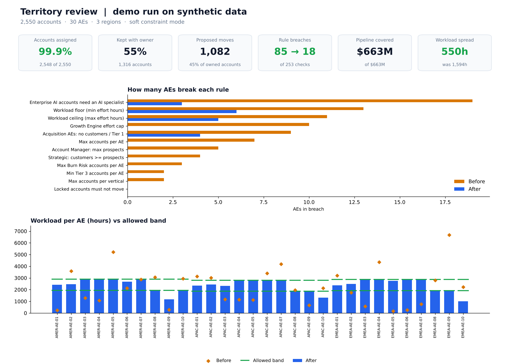
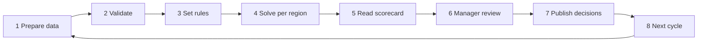
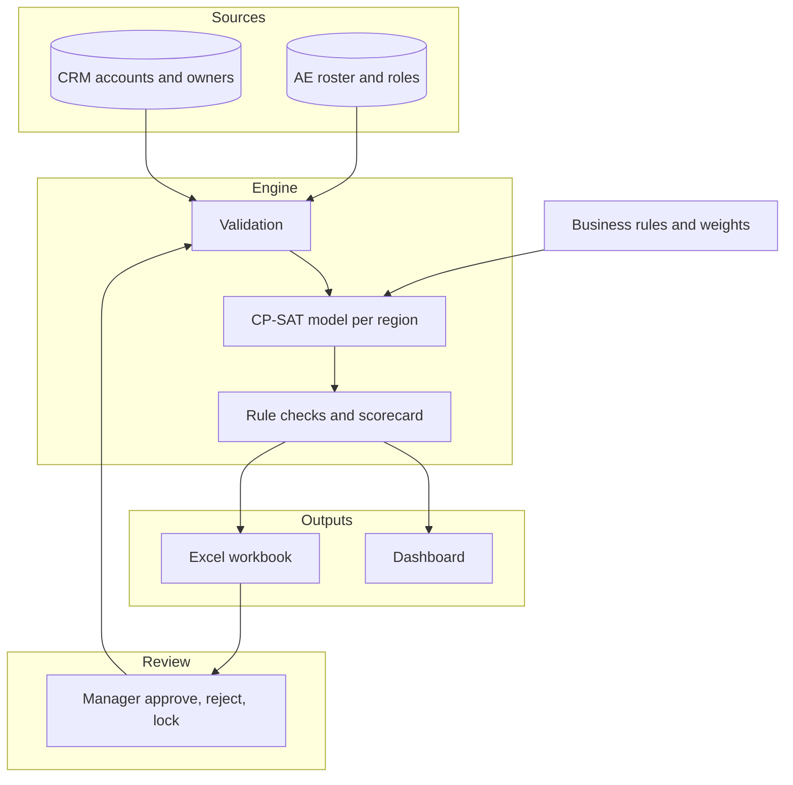

# Territory Optimisation Engine

[](https://colab.research.google.com/github/5d7/territory-optimisation-engine/blob/main/Territory_Optimisation_Engine_v2.ipynb)


**A constraint-based territory planning engine for revenue operations.** It reviews account ownership region by region, proposes which accounts move into or out of each AE's territory, enforces your business rules, and explains every move in plain English. The result is a repeatable, auditable planning cycle instead of a once-a-year spreadsheet exercise.



*Demo run on randomly generated data: 2,550 accounts, 30 AEs, 3 regions. The synthetic starting point is deliberately messy, so the move count is high. Real portfolios are tuned with the stability and move-limit controls described below.*

## Contents

1. [Why this exists](#why-this-exists)
2. [What it delivers](#what-it-delivers)
3. [The operating model, step by step](#the-operating-model-step-by-step)
4. [Business use cases](#business-use-cases)
5. [How to read the results](#how-to-read-the-results)
6. [Tuning guide](#tuning-guide)
7. [Tools and API potential](#tools-and-api-potential)
8. [Architecture](#architecture)
9. [Quick start](#quick-start)
10. [Input format](#input-format)
11. [Governance, data and privacy](#governance-data-and-privacy)
12. [Roadmap](#roadmap)

## Why this exists

Territory and account assignment drive coverage, capacity, quota attainment and rep retention, yet most teams manage them in spreadsheets. The usual symptoms:

- Accounts with no owner, or with an owner who should not hold them
- Uneven workload, with some reps saturated and others under-used
- Specialist accounts sitting with non-specialists
- Rebalancing that is slow, political, and hard to explain afterwards
- No fast way to answer "what if we change this rule?"

The engine turns those rules into a mathematical model, solves it per region, and reports exactly what it could and could not satisfy.

## What it delivers

| Question a RevOps leader asks | What the engine provides |
|---|---|
| Is every account covered by the right person? | Coverage figure and a rule scorecard, before and after |
| Is workload fair? | Effort per AE against an allowed band, with spread before and after |
| How disruptive is the rebalance? | Accounts kept with their owner, total moves, per-AE in and out limits |
| Why did this account move? | A plain-English reason on every proposed move |
| What if we tighten a rule? | Side-by-side scenario comparison |
| Can managers shape the outcome? | Approve, reject or lock moves, then loop decisions into the next cycle |
| Can I audit it later? | Excel workbook with run summary, settings, moves, scorecard and data-quality checks |

## The operating model, step by step



| Step | What you do | What you get |
|---|---|---|
| 1. Prepare data | Export accounts and the AE roster into the two-sheet workbook | A clean input file |
| 2. Validate | Run the engine. It checks columns, duplicate IDs and AE names | A data-quality table, and blocking errors are stopped before solving |
| 3. Set rules | Choose role limits, workload band, portfolio caps, stability controls and soft or hard mode | A saved settings object that is recorded in the output workbook |
| 4. Solve per region | Run the review. Each region is solved independently with CP-SAT | Solution status per region (OPTIMAL or FEASIBLE) and a plan-quality gap |
| 5. Read the scorecard | Check coverage first, then rule breaches before and after, then the move list | A clear view of which rules the plan could not fully satisfy |
| 6. Manager review | Send the workbook to sales managers. They mark each move Approve or Reject and can lock accounts | Human decisions captured in the file |
| 7. Publish decisions | Apply approved moves in your CRM through your normal process | A new system-of-record state |
| 8. Next cycle | Upload the reviewed workbook to build the next input file. Approved moves become the new owner, and rejected moves stay with the current AE and are locked | A review that improves each cycle instead of restarting |

## Business use cases

Each use case has a full step-by-step playbook in **[use-cases.md](use-cases.md)**.

| Use case | Trigger | Outcome you take to leadership |
|---|---|---|
| Annual territory planning | New fiscal year, before quotas are released | Full coverage plan with a rule scorecard |
| Mid-year rebalancing | Pipeline shift or saturated reps | The smallest set of moves that restores balance |
| Attrition and new-hire coverage | A rep leaves or a cohort starts | A fair redistribution of orphaned accounts |
| Specialist alignment | A product line needs specialist coverage | Before and after specialist coverage, with reasons |
| Portfolio risk balancing | Uneven at-risk or high-effort books | Risk and growth workload spread by design |
| Scenario analysis | "What if the account cap changes?" | A quantified trade-off between disruption and compliance |
| M&A and segmentation change | New accounts or new role definitions | A reasoned integration of the new book |
| Quarterly review cycle | Recurring planning cadence | An audit trail of proposals and manager decisions |

## How to read the results

Read in this order, because each layer tells you whether to trust the next.

1. **Coverage card.** If accounts are unassigned, stop and diagnose before reading anything else. Short solve times, tight move caps and hard mode can all reduce coverage.
2. **Region status.** `OPTIMAL` means the best plan was proven. `FEASIBLE` means a good plan was found but more time could improve it. `INFEASIBLE` in hard mode means rules clash, and the note names them.
3. **Rule scorecard.** Shows, per rule, how many AEs were in breach before and after, and by how much. This is the honest summary of what the plan could not fix.
4. **Workload chart.** Each AE's effort after the plan against the allowed band.
5. **Moves sheet.** Each proposed move with its reason. This is what managers review.

## Tuning guide

| If you see | Consider adjusting | Notes |
|---|---|---|
| Too many moves | `stability_bonus`, `max_moves_pct`, `max_in_per_ae`, `max_out_per_ae` | Tighter caps reduce disruption, but can leave rules unmet or accounts unassigned, so re-check coverage |
| Accounts unassigned | Solve time (`max_time_per_region_seconds`), `require_full_coverage`, move caps | Longer solves generally find better plans |
| Rules still breached in soft mode | The matching weight (`w_cap`, `w_tier3`, `w_burn`, and so on) | Raise a weight to protect that rule more strongly |
| Region infeasible in hard mode | Relax one clashing rule, or switch to soft mode | The region note lists the conflicting rules |
| Workload too uneven | `allowed_workload_variance_pct`, `balance_weight` | A narrower band is fairer but harder to satisfy |
| Accounts that must not move | Set `Locked` in the input and keep `respect_locked` on | Locked accounts stay with their owner |
| Results change between runs | `random_seed`, solve time | Fix the seed for repeatable runs |

In my own test runs, a shorter solve and a higher stability bonus both lowered coverage compared with a longer default solve, so treat coverage as a metric to watch whenever you tighten something.

## Tools and API potential

The engine works today through Excel in and Excel out, in Colab or locally. It is also designed to sit inside a larger revenue-operations stack. Full detail, with code, is in **[integrations.md](integrations.md)**.

| Layer | Potential integration | What it would unlock | Status |
|---|---|---|---|
| Input | CRM export, data warehouse table, Google Sheets | Fresh accounts and AE roster without manual copying | Excel and DataFrame input available today. Warehouse and CRM connectors are extensions |
| Orchestration | n8n, Cloud Run jobs, scheduled notebooks | Quarterly or on-demand runs without anyone opening a notebook | Extension |
| Review | Slack or Teams digests, Sheets-based approval | Managers approve moves where they already work | Extension |
| AI layer | LLM summaries of the scorecard and per-manager briefings | Plain-English executive narrative and Q&A over results | Extension |
| Agents | An MCP server exposing run, inspect and explain tools | Agents that can propose and explain territory changes on request | Extension |
| Write-back | CRM API update of account owners | Approved moves applied automatically, with an audit trail | Extension, approval-gated |
| Planning links | Quota, capacity and compensation models | Territory decisions that flow into plans consistently | Extension |

## Architecture



## Quick start

1. Click **Open in Colab** above.
2. Run the install cell, then the engine cell.
3. Run the settings cell and adjust the sliders, or keep the defaults. Demo data is built in.
4. Run the review, then download the Excel workbook.

To run locally:

```bash
pip install -r requirements.txt
jupyter notebook Territory_Optimisation_Engine_v2.ipynb
```

To call the engine from code, see the tested example in [integrations.md](integrations.md#calling-the-engine-from-code).

## Input format

An Excel workbook with two sheets, `Accounts` and `AE_Roles`.

| Sheet | Columns |
|---|---|
| `Accounts` | Account ID, Account Name, Region, Product Focus, Current AE, Annual Revenue, Estimated Effort (Hours), Status, Tier, Money Map, Vertical, Locked |
| `AE_Roles` | AE Name, Role, Region Alignment, Is_AI_Specialist |

Column names must match exactly. The last notebook cell downloads a blank template.

## Governance, data and privacy

- All demo data and the preview image are synthetic. No company data, customer names or real financials are in this repository.
- The engine proposes. People decide. Moves are reviewed by managers before anything is applied.
- Every run records its settings, solver status and data-quality results in the output workbook, so decisions can be reconstructed later.
- If you run it on real data, keep input and output workbooks out of version control. The `.gitignore` excludes `.xlsx` files by default.

## Roadmap

- [ ] Move the engine into an importable Python package with tests
- [ ] Command-line runner for scheduled reviews
- [ ] Warehouse and CRM connectors for input
- [ ] MCP server exposing run, inspect and explain tools
- [ ] Approval-gated CRM write-back
- [ ] Additional rule types (named-account protection, language alignment)
- [ ] Historical attainment as an input to capacity bands
