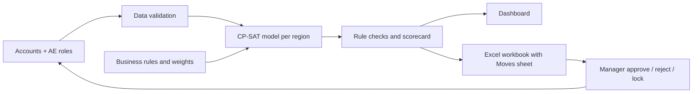

# Territory Optimisation Engine

[](https://colab.research.google.com/github/5d7/territory-optimisation-engine/blob/main/Territory_Optimisation_Engine_v2.ipynb)

A constraint-based territory optimiser that reviews account ownership region by region and proposes which accounts to move into or out of each AE's territory. It respects your business rules and explains every proposed move in plain English. Built with Google OR-Tools (CP-SAT).

**The demo runs on built-in synthetic data.** No company data is included in this repository.

## Quick start

1. Click **Open in Colab** above.
2. Run the install cell, then the engine cell.
3. Run the settings cell and adjust the sliders, or keep the defaults.
4. Run the review, then download the Excel workbook.

To run locally instead:

```bash
pip install -r requirements.txt
jupyter notebook Territory_Optimisation_Engine_v2.ipynb
```

## How it works



## What it handles

- **Role limits:** maximum accounts per AE, strategic account caps, account-manager prospect caps
- **Alignment:** region matching and AI-specialist routing for AI-focused accounts
- **Portfolio balance:** Spend Map mix (Burn Risk and Growth Engine caps, effort cap), Tier 3 minimums, vertical anti-silo limits
- **Fairness:** workload variance across AEs
- **Stability:** churn control, move limits, locked accounts, and a stability bonus
- **Soft vs hard mode:** soft mode bends rules only when no other plan exists and reports what is still outside the rules; hard mode flags infeasible regions
- **Continuous review cycle:** managers approve, reject, or lock moves, and the reviewed workbook becomes the next cycle's input
- **Scenario comparison:** re-run with changed settings and compare side by side

## Input format

An Excel workbook with two sheets, `Accounts` and `AE_Roles`. Required `Accounts` columns include Region, Product Focus, Status, Tier, **Spend Map**, Vertical, and Current AE. The notebook's input section lists every column, and a blank template can be downloaded from the last cell.

## Roadmap

- [ ] Move the engine into an importable Python package with tests
- [ ] Command-line runner for scheduled reviews
- [ ] Additional rule types (named-account protection, language alignment)
