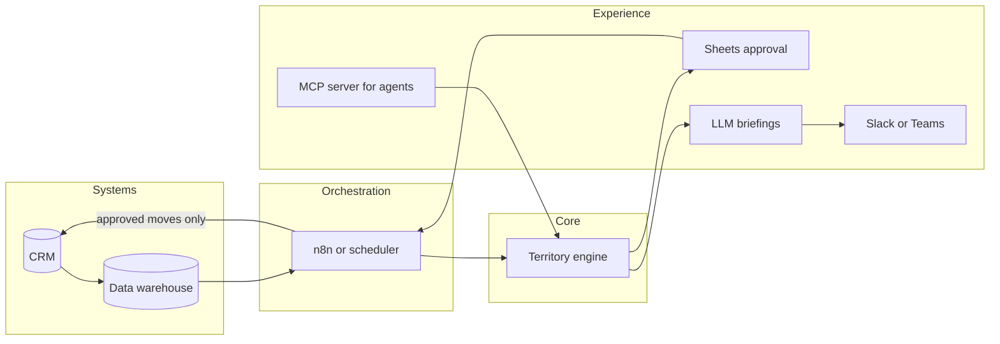

# Tools and API potential

This document separates what works today from what is a natural extension. Nothing marked **Extension** is implemented in this repository. The code for those items is illustrative and untested, and is there to show the shape of the integration.

| Status | Meaning |
|---|---|
| **Available** | Works in the notebook today and was tested |
| **Extension** | A realistic next step, not built here |

## Reference architecture



## Calling the engine from code

**Status: Available.** After running the engine cell, the main functions can be used directly with DataFrames. This is the foundation for every integration below.

```python
# Run in a notebook cell after the engine cell has been executed
cfg = Config(
    use_demo_data=True,            # set False and pass your own DataFrames for real data
    constraint_mode="soft",
    max_time_per_region_seconds=120,
)

df_acc, df_ae = load_data(cfg)     # replace with DataFrames from your warehouse
res = run_territory_review(cfg, df_acc, df_ae, quiet=True)

print(res.kpis["coverage_pct"], res.kpis["moves"],
      res.kpis["breaches_before"], res.kpis["breaches_after"])

moves = res.moves[res.moves["Action"] == "Move"]
print(moves[["Account ID", "Current AE", "Proposed AE", "Move Reason"]].head())

export_excel(res, path="territory_review.xlsx", download=False)
```

`res.moves` has an `Action` column. Besides `Move`, it can contain `Reassigned (owner unavailable)` for accounts whose previous owner is no longer in the roster, so include both when you want every ownership change.

The result object also exposes `scorecard`, `ae_summary`, `region_summary`, `unassigned`, `rule_detail` and `data_quality` as DataFrames. The exported workbook contains the sheets README, Run Summary, Region Status, Moves, Rule Scorecard, AE Summary, Assignments, Unassigned, Rule Detail, Pre-flight, Data Quality, Settings and AE_Roles.

Note that coverage depends on solve time and on how tightly you constrain moves, so check `coverage_pct` after every run.

## 1. Inputs: warehouse and CRM

**Status: Extension.**

**Potential.** Replace manual exports with a query that always reflects the current book of business.

**Steps**
1. Create a warehouse view that returns the account columns listed in the README input format.
2. Create a second view for the AE roster.
3. Load both into DataFrames and pass them to `run_territory_review`.
4. Map CRM fields to the engine's column names in one place, so schema changes are easy to manage.

```python
# Illustrative: BigQuery as the source
from google.cloud import bigquery
client = bigquery.Client()
df_acc = client.query("SELECT * FROM `project.revops.territory_accounts`").to_dataframe()
df_ae  = client.query("SELECT * FROM `project.revops.territory_ae_roles`").to_dataframe()
```

## 2. Orchestration: n8n or a scheduler

**Status: Extension.**

**Potential.** Run the review on a schedule or on demand, with no one opening a notebook.

**Steps**
1. Package the engine as a script or container (see roadmap).
2. Trigger it from n8n on a schedule, or from a webhook when an AE leaves or a plan is requested.
3. Have it write the workbook to cloud storage and return the KPIs as JSON.
4. Pass the KPIs to the next workflow step for notification.

Suggested workflow shape: schedule trigger, query warehouse, run engine, store workbook, notify managers, wait for approvals, apply approved moves.

## 3. Review: Slack, Teams and Sheets

**Status: Extension.**

**Potential.** Managers approve moves where they already work.

**Steps**
1. Publish each manager's moves to a Google Sheet with an Approve and Reject column.
2. Post a Slack message per manager with a link and a short summary.
3. When decisions are in, read the sheet back into the "next cycle" input.
4. Report the approval rate and outstanding decisions to RevOps.

## 4. AI layer: briefings and Q&A

**Status: Extension.**

**Potential.** Turn the scorecard into narrative for executives, and a per-manager briefing for each region. The engine already writes a reason per move. An LLM can add the layer above that: summaries, trade-off explanations and answers to questions about the plan.

**Steps**
1. Take `res.kpis`, `res.scorecard` and a manager's slice of `res.moves`.
2. Send them to an LLM with a prompt that asks for a short summary, the top risks and the questions to ask the team.
3. Post the result to Slack or include it in the workbook.
4. Keep the LLM strictly descriptive. The solver decides moves. The model explains them.

```python
# Illustrative and untested: summarise a run with the Anthropic API.
# Check the current model names in the Anthropic docs before using.
import anthropic, json
client = anthropic.Anthropic()
context = {
    "kpis": res.kpis,
    "scorecard": res.scorecard.to_dict("records"),
    "sample_moves": moves.head(20)[["Account ID", "Current AE", "Proposed AE", "Move Reason"]].to_dict("records"),
}
msg = client.messages.create(
    model="claude-sonnet-5-5",
    max_tokens=800,
    messages=[{"role": "user", "content":
        "Write a five-sentence executive summary of this territory review, "
        "then list the three biggest risks. Use only the data provided.\n"
        + json.dumps(context, default=str)}],
)
print(msg.content[0].text)
```

## 5. Agents: an MCP server

**Status: Extension.**

**Potential.** Expose the engine as tools that an AI agent can call: run a review, list moves for a manager, explain why an account moved, compare two scenarios.

**Suggested tools**
- `run_review(settings)` returning the KPIs and a run ID
- `get_moves(run_id, manager)` returning that manager's moves with reasons
- `explain_move(run_id, account_id)` returning the reason and the rules involved
- `compare_scenarios(settings_a, settings_b)` returning a side-by-side table

**Guardrails.** Tools should be read-only by default. Anything that changes a system of record needs explicit human approval.

## 6. Write-back: applying approved moves

**Status: Extension.**

**Potential.** Close the loop by updating account owners in the CRM.

**Steps**
1. Read the reviewed workbook returned by managers and keep every ownership change that was not rejected. A blank Manager Decision counts as Approve, and reassignments of accounts whose owner left cannot be rejected.
2. Map each AE name to a CRM user ID.
3. Test in a sandbox environment first.
4. Write the updates in batches and log each change with the run ID.
5. Keep a rollback list of the previous owners.

```python
# Illustrative and untested: apply approved moves with simple-salesforce
from simple_salesforce import Salesforce
import pandas as pd
sf = Salesforce(username="...", password="...", security_token="...")  # use secrets management, never hard-code
reviewed = pd.read_excel("reviewed_workbook.xlsx", sheet_name="Moves")
changes = reviewed[reviewed["Action"].isin(["Move", "Reassigned (owner unavailable)"])]
approved = changes[changes["Manager Decision"].fillna("Approve") != "Reject"]
for _, m in approved.iterrows():
    sf.Account.update(m["Account ID"], {"OwnerId": user_id_by_ae[m["Proposed AE"]]})
```

Account IDs in the engine would need to match the CRM record IDs, and the update should run only after review and approval.

## 7. Planning links: quota and capacity

**Status: Extension.**

**Potential.** Territory output is the input to quota and capacity planning. A consistent export of accounts, revenue and effort per AE can feed quota-setting models, capacity models and compensation plans, so those plans start from the same territory view.

## Security and governance checklist

- Keep credentials in a secrets manager, never in notebooks or repositories.
- Use synthetic or masked data in any public demo.
- Require human approval before any write to a system of record.
- Log every run: settings, solver status, data-quality results and who approved what.
- Restrict access to workbooks that contain real revenue and ownership data.
